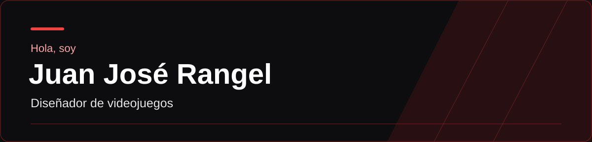

  

  
  
  
  

# Hola, soy Juan José Rangel

## 

Actualmente acabo de formárme en el área de Desarrollo de Software, aprendiendo sobre creación de aplicaciones, desarrollo web y manejo de herramientas utilizadas en proyectos reales.

Me interesa el diseño de niveles y mecánicas de un videojuego llevando a cabo estrategias que garanticen que un videojuego esté bien planteado y que además cuente con una visión creativa.

---

## 

- Desarrollador de Software en Campuslands
- Con conocimientos en desarrollo web y programación
- Interesado en diseño y creación de experiencias digitales
- Siempre buscando mejorar y aprender nuevas tecnologías
- Me gusta trabajar en equipo y aportar ideas dentro de los proyectos

## 

### Desarrollo
- HTML
- CSS
- JavaScript
- Python
- MySQL

### Herramientas
- Git
- GitHub
- Visual Studio Code
- Game Maker Studio

### Metodologías
- Scrum

## 

<table>
  <tr>
    <td width="33%" valign="top">
      <h3>Sitio Web</h3>
      
Desarrollo de apartado visual de una página web de compras en línea usando los lenguajes de código HTML y CSS usando recursos de Figma para darle una apariencia profesional.

    </td>
    <td width="33%" valign="top">
      <h3>Portafolio web personal</h3>
      
Diseño y desarrollo de una página web tipo hoja de vida utilizando HTML y CSS, enfocada en presentar mi perfil, habilidades y proyectos.

    </td>
    <td width="33%" valign="top">
      <h3>Videojuego de plataformas 2D</h3>
      
Proyecto personal enfocado en la dirección creativa y en desarrollo de videojuego en Game Maker Studio.

    </td>
  </tr>
</table>

## 

Puedes conocer más sobre mi perfil y proyectos aquí:

https://juan2509.github.io/Portafolio-Web-Juan-Jose-Rangel/

---

## 

Aquí podrás ver mi hoja de vida:

https://juan2509.github.io/Portafolio-Web-Juan-Jose-Rangel/Hoja%20de%20Vida%20Juan%20Rangel.pdf

---

## 

juanjosericardorangelsandoval@gmail.com

GitHub:
https://github.com/Juan2509

LinkedIn:
www.linkedin.com/in/juan-josé-ricardo-rangel-sandoval-8729b5419

Gmail: juanjosericardorangelsandoval@gmail.com
